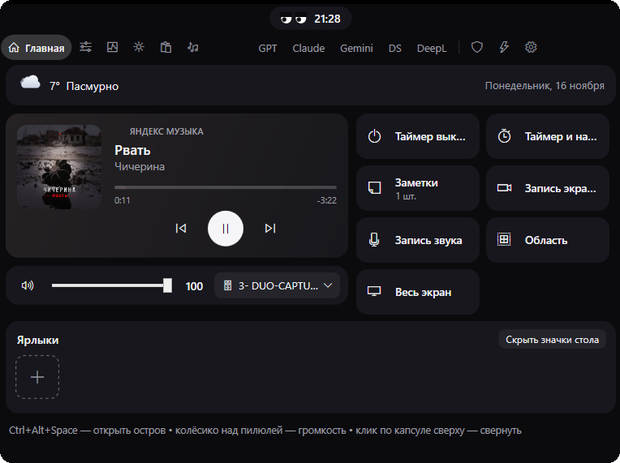
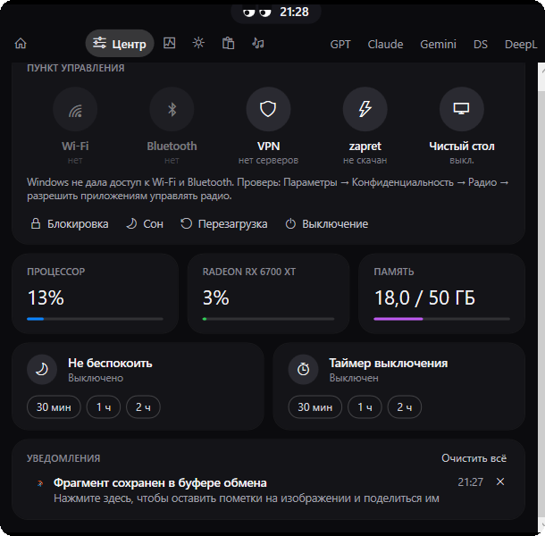
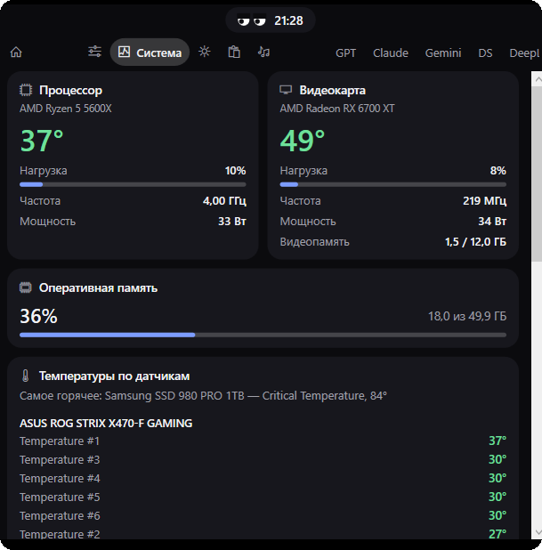
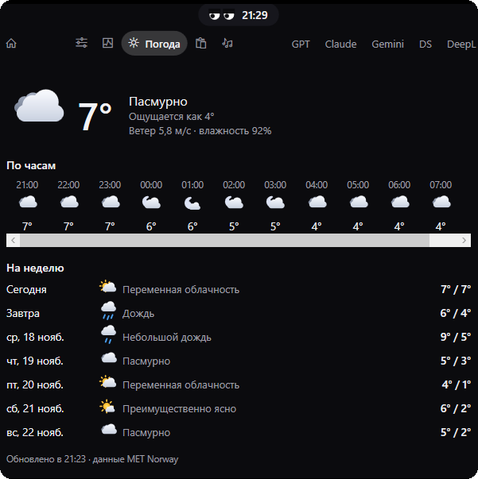
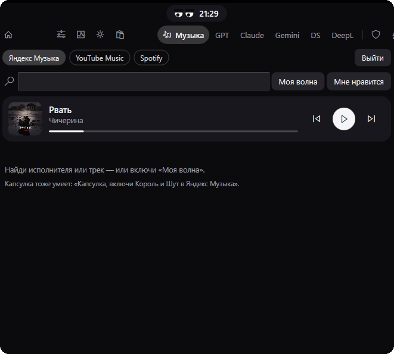
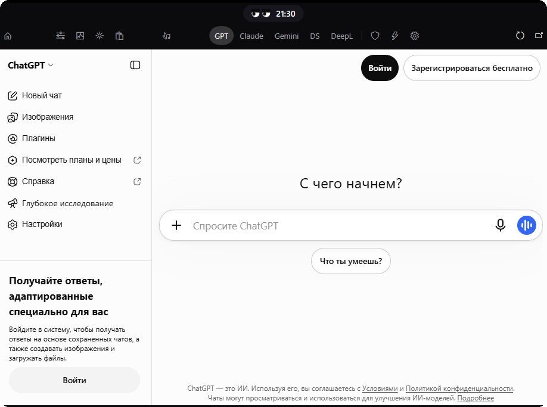
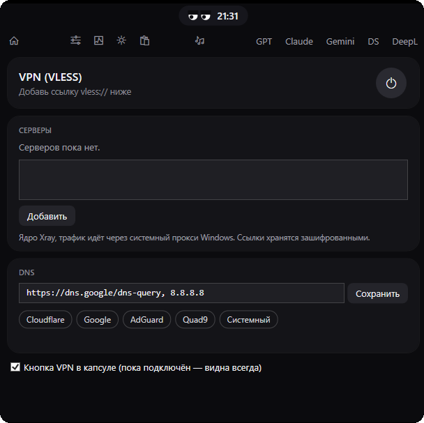
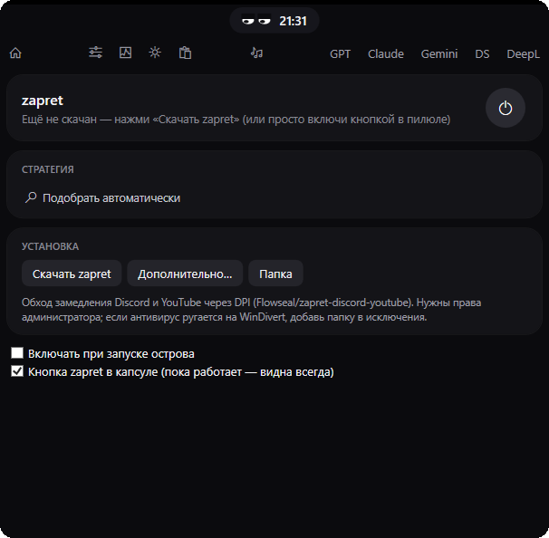
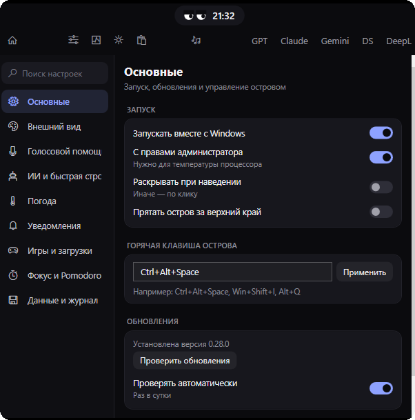

<div align="center">

# 💊 Капсула

### Dynamic Island для Windows 10/11: ИИ, музыка, голосовой помощник и весь компьютер в одной живой пилюле

[](#-установка)
[](#-сборка-из-исходников)
[](../../actions/workflows/build.yml)
[](../../releases/latest)


<br><br>



**Скажи «Капсулка», и она уже слушает.**

[Скачать](../../releases/latest) · [Возможности](#-возможности) · [Как пользоваться](#-как-пользоваться) · [Планы](#-в-планах)

</div>

---

## ✨ Что это

**Капсула** (Wikar Island) — чёрная пилюля в верхней части экрана. Она живёт поверх всех окон, не отбирает фокус и показывает, что происходит: играющий трек, погоду, уведомления, загрузки Steam, таймеры. По клику пилюля вырастает в панель с ИИ-чатами, плеером, буфером обмена, VPN и показателями ПК.

У пилюли есть характер: глаза следят за курсором, моргают и засыпают. Нижний край тянется каплей к мыши, рябит в такт музыке и вздрагивает от уведомлений.

Проект написан с нуля на **C# + WPF + WebView2**.

<table>
  <tr>
    <td align="center"><br><sub><b>Центр</b>: Wi-Fi, VPN, zapret, нагрузка, «Не беспокоить», уведомления</sub></td>
    <td align="center"><br><sub><b>Система</b>: температуры, нагрузка и частоты CPU и GPU</sub></td>
  </tr>
  <tr>
    <td align="center"><br><sub><b>Погода</b>: по часам и на неделю</sub></td>
    <td align="center"><br><sub><b>Музыка</b>: Яндекс Музыка, YouTube Music и Spotify</sub></td>
  </tr>
</table>

---

## 🚀 Возможности

### 🎙️ Голосовой помощник «Капсулка»

<p align="center"><br><sub>«Капсулка, открой Discord» — и ответ прямо в пилюле</sub></p>

- Откликается на **«Капсулка»**, **«Капсула»**, **«Капсуль»** и **«Капс»**
- **Gemini Live**: живой голосовой разговор без пауз
- **Groq**: быстрый режим, мгновенное распознавание команд
- **Ollama**: локальный «мозг» прямо на вашем ПК
- Открывает, закрывает и сворачивает программы и игры, жмёт кнопки внутри приложений (например, «Играть» в Battle.net)
- «Освободи память», «закрой всё, кроме …»
- Включает музыку во встроенном плеере: «включи Сплин в Яндекс Музыке»
- **Видео YouTube** по названию и управление голосом: «включи на ютубе …», «следующее видео», «перемотай на 5:30», «качество 1080», «на весь экран», «мини-плеер»
- **Системные программы Windows** (около 180 пунктов): диспетчер задач, микшер громкости, службы, просмотр событий, параметры Wi-Fi и экрана, автозагрузка, папка AppData, эмодзи, Game Bar…
- **Громкость отдельной программы**: «сделай Discord потише», «громкость браузера 30», «выключи звук в Spotify»
- Голос на выбор, в том числе **свой голос через Fish Audio** (ваш ключ + ID голоса)
- **Профиль**: имя и пол — Капсулка обращается «сэр», «мэм», «мистер Илья», «мисс Олеся», «господин/госпожа» или как вы сами зададите

### 🤖 ИИ-чаты
- **ChatGPT, Claude, Gemini, DeepSeek** и переводчик **DeepL** во вкладках, без платного API: вход в свои аккаунты сохраняется
- Любой чат можно открыть в отдельном окне

<p align="center"></p>

### 🎵 Музыка

<p align="center"></p>

- Что играет сейчас (Яндекс Музыка, Spotify, YouTube и др.): управление, перемотка, значок источника
- Свечение пилюли и эквалайзер в цвет обложки
- **Встроенный плеер** с входом в свой аккаунт и поиском:
  - **Яндекс Музыка** играет прямо в острове: «Моя волна», «Мне нравится» (полные треки с Плюсом)
  - **YouTube Music**: вход в Google общий с ИИ-вкладками
  - **Spotify** через Spotify Connect (нужны свой Client ID и Premium)
  - **В Discord**: музыка из Яндекс Музыки и YouTube Music играет в голосовом канале через своего бота [Capsul Radio](https://github.com/Wikaar/Capsul-Radio-DSBot), на компьютере — без звука
- **YouTube (видео)** в своём окне: обычное окно, весь экран (кнопка, F, двойной клик или голосом) и мини-плеер поверх всех окон; пропуск рекламы и блокировщик uBlock Origin Lite (если встроенный браузер его поддерживает); «открыть в браузере» с того же места

### 🌤️ Погода
Цветные значки и температура в пилюле, прогноз по часам и на неделю (MET Norway), поиск города.

### 🔔 Уведомления и Discord
- Карточки уведомлений Windows на пилюле: клик выводит программу вперёд, даже из трея
- Счётчик новых сообщений Discord
- История уведомлений на «Главной» и список программ-исключений

### 🎮 Steam
- Прогресс загрузок в пилюле, текущая игра и время в ней
- Карточка «игра готова»: клик запускает игру

### 🌐 Сеть: zapret и VPN
- **zapret**: Discord и YouTube без VPN. Остров сам скачивает и обновляет [Flowseal/zapret-discord-youtube](https://github.com/Flowseal/zapret-discord-youtube), подбирает рабочую стратегию и умеет всё из `service.bat`
- **VPN (VLESS)** на встроенном ядре Xray: Reality/TLS, транспорты tcp, ws, grpc, xhttp и httpupgrade, пресеты DNS и DoH. Ссылки хранятся зашифрованными
  - режим **системного прокси** — браузеры и программы с прокси Windows
  - режим **TUN** (как в v2rayN, через sing-box) — весь трафик компьютера: игры, голос Discord (UDP), приложения Store, DNS; без утечек, локальная сеть напрямую. Нужны права администратора

<table>
  <tr>
    <td align="center"><br><sub>VPN на ядре Xray</sub></td>
    <td align="center"><br><sub>zapret с автоподбором стратегии</sub></td>
  </tr>
</table>

### 🖥️ Система и инструменты
- **Показатели ПК**: CPU и GPU (температура, нагрузка, частота, мощность), видеопамять, RAM, все датчики (LibreHardwareMonitor)
- **Звук**: громкость колёсиком над пилюлей, mute, смена аудиовыхода в один клик
- **Буфер обмена**: история текста и картинок, закрепление, поиск. Записи из менеджеров паролей не сохраняются
- **Центр управления**: Wi-Fi, Bluetooth, значки рабочего стола, сон, перезагрузка, выключение
- **Быстрые действия**: заметки, запись экрана в MP4 со звуком, запись звука, скриншоты
- **Таймер выключения**: выключение, перезагрузка, сон или гибернация через N минут, в заданное время или «после текущего трека»
- **Ярлыки**: плитки программ, папок и файлов на «Главной», режим «Чистый экран»

### 🎨 Пилюля
- **Тёмная и светлая тема**
- **Неоновая окантовка** со свечением: 9 цветов или свой; раскрытая капсула со скруглёнными углами и окантовкой
- Раскрытие по клику, наведению или горячей клавише; сверху или снизу, смотря где стоит пилюля
- Открепление и перетаскивание с прилипанием к краям, своя позиция на каждом мониторе
- **7 стилей глаз**: классические, кошачьи, робот, мультяшные, сонные, сердитые, пиксельные
- Автоскрытие за верхний край, срастание с рамкой монитора, как у выреза
- Настройки по разделам: Основные, Профиль, Внешний вид, Голос, ИИ, Погода, Уведомления, Игры, Фокус, Данные

<p align="center"></p>

---

## 📦 Установка

1. Откройте [**последний релиз**](../../releases/latest)
2. Скачайте `WikarIsland-vX.Y.Z-win-x64.zip` и распакуйте в любую папку **целиком**
3. Запустите `WikarIsland.exe`

Нужна Windows 10 версии 1809 или новее либо Windows 11. Сборка самодостаточная, .NET ставить не нужно. WebView2 уже есть в Windows 10/11; если нет, установите «Microsoft Edge WebView2 Runtime» с сайта Microsoft.

> Все версии собираются автоматически в **GitHub Actions**. Самая свежая сборка после каждого изменения лежит в [**Actions → Build**](../../actions/workflows/build.yml) → последний зелёный запуск → **Artifacts**.

---

## 🕹️ Как пользоваться

| Действие | Что происходит |
|---|---|
| **Клик** по пилюле | Остров раскрывается; клик в другом месте сворачивает его |
| **Ctrl + Alt + Space** | Открыть остров с клавиатуры (меняется в настройках) |
| **Правый клик** по пилюле | Открепить и переместить, вернуть в центр, настройки, выход |
| **Колёсико** над пилюлей | Громкость |
| **«Капсулка, …»** | Голосовая команда |
| Иконка в трее | То же меню, что по правому клику |

Уведомления остров читает из базы центра уведомлений Windows (только чтение), поэтому видит то же, что попадает туда. Если у программы уведомления там выключены, остров их тоже не увидит.

Для температуры CPU, zapret и VPN нужны права администратора. Автозапуск с админ-правами включается в настройках через Планировщик.

Настройки лежат в `%AppData%\WikarIsland\settings.json`, ошибки в `%AppData%\WikarIsland\error.log`.

---

## 🛠️ Сборка из исходников

Нужен .NET 10 SDK.

```bash
dotnet run --project src/WikarIsland
dotnet publish src/WikarIsland -c Release -r win-x64 --self-contained true -o publish
```

Новый релиз выходит сам при смене `<Version>` в `WikarIsland.csproj` на `main` или по тегу `v*`.

---

## 🗺️ В планах

- [ ] ⚡ Быстрый вопрос: выделил текст → горячая клавиша → текст в ИИ-чате
- [ ] 🎤 Текст песни в такт (LRCLIB)
- [ ] 🎚️ Микшер громкости по программам
- [ ] 🎧 Горячая клавиша смены аудиовыхода и карточка при подключении наушников
- [ ] 🕹️ Игровой режим: целые сценарии одной фразой

Есть идея или нашли баг? [Создайте Issue](../../issues).

---

<div align="center">

Если Капсула вам понравилась, поставьте ⭐: это очень мотивирует!

Сделано с ❤️ by [Wikaar](https://github.com/Wikaar)

</div>
